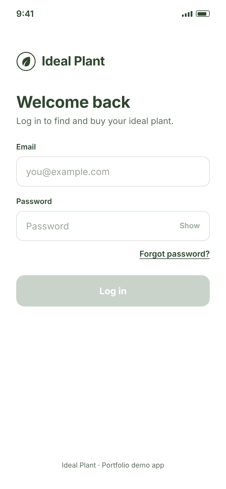
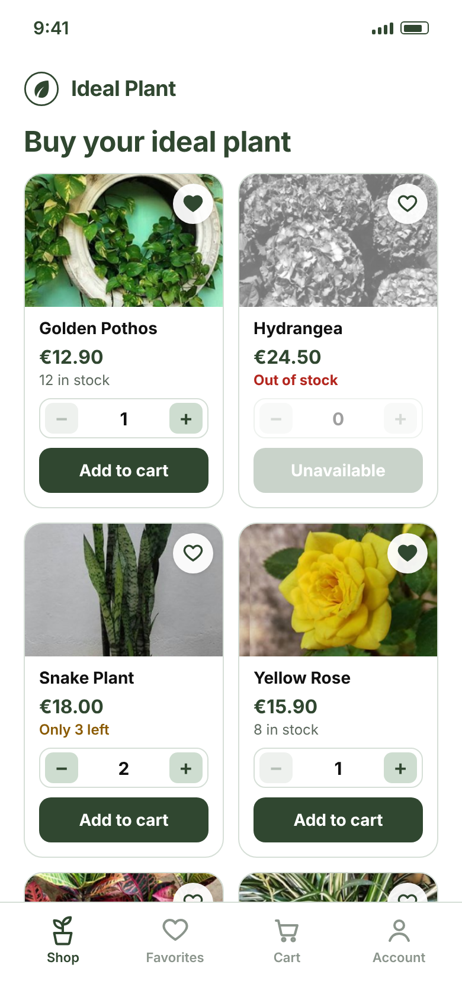
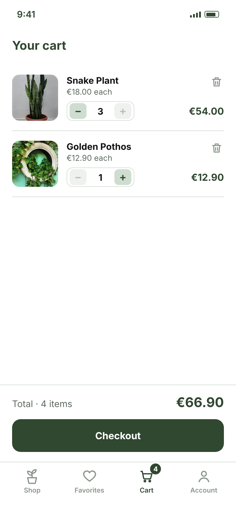
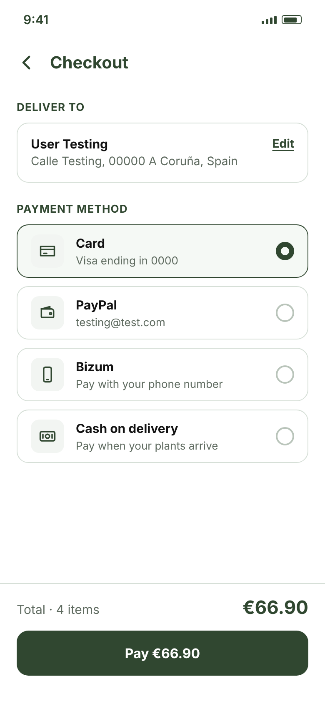
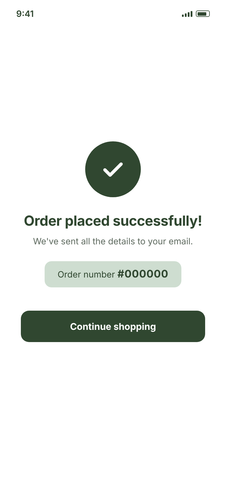

# Ideal Plant — Manual and Maestro Testing

QA portfolio project for **Ideal Plant**, a concept mobile app (iOS and Android) for buying plants. It covers the full QA process: requirements, manual test cases and an end-to-end flow automated with [Maestro](https://maestro.dev).

The plant photos are my own, taken from my first web project, *The Ideal Plant*.

<p>
  
  
  
  
  
</p>

> **Ideal Plant is a concept app.** The screens are mockups and there is no app build, so the Maestro flow cannot be run. It shows how the automation would be written and reviewed for a real app.

## What's in this repository

| Folder / file | Content |
|---|---|
| [`docs/requirements.md`](docs/requirements.md) | 47 requirements, screen by screen, with the screens, out-of-scope items and test data |
| [`docs/test-cases.md`](docs/test-cases.md) | 40 manual test cases in Given / When / Then, with priority and automation candidates |
| [`docs/accessibility-ids.md`](docs/accessibility-ids.md) | The accessibility IDs the developers must add for the automated tests |
| [`docs/screens/`](docs/screens) | The app screens |
| [`agents/`](agents) | Instructions of the two AI agents used in the automation phase |
| [`automation/maestro/`](automation/maestro) | The Maestro E2E purchase flow |
| [`automation/reports/`](automation/reports) | The reviewer agent's reports, with my decision on each finding |

## How the project was built

**Requirements and manual test cases** were written with an AI assistant (Claude). I defined the app, reviewed every requirement and test case group by group, and made the decisions: what is in and out of scope, priorities, test data and edge cases (for example, how the stock and the cart limit the quantity a user can add).

**Automation** was done with two AI agents, each with its own instructions:

`QA instruction → Maestro Automation Agent → Automation Reviewer Agent → QA approval`

- The **[Maestro Automation Agent](agents/maestro-automation-agent.md)** turns approved test cases into Maestro flows and proposes the accessibility IDs the app needs.
- The **[Automation Reviewer Agent](agents/automation-reviewer-agent.md)** reviews the result against the requirements, test cases and instruction. It only reports; it does not change files. The automation is never reviewed by the agent that wrote it.
- **I approve or reject** each finding. The decisions are recorded in the review reports (three rounds for this flow).

## Automation

### Structure

```
automation/maestro/
├── commons/                  steps reused by many flows
│   ├── open_app.yaml
│   └── login_base.yaml
├── scenarios/                one folder per app area, one file per scenario
│   ├── shop/add_to_cart.yaml
│   ├── cart/review_cart.yaml
│   ├── checkout/pay_with_card.yaml
│   └── confirmation/order_placed_successfully.yaml
└── suite/                    the tests that run: they chain commons and scenarios
    └── e2e_purchase.yaml
```

### The E2E purchase flow

Open the app → log in → add 2 units of the first plant → check the Cart → pay with Card → order placed → back to the Shop.

It follows 8 manual test cases: TC-SPL-02, TC-LOG-06, TC-SHOP-04, TC-CART-01, TC-CART-07, TC-CHK-06, TC-CONF-01 and TC-CONF-03. Each common and scenario starts with the test case IDs.

### How to run (on a real build)

```bash
maestro test automation/maestro/suite/e2e_purchase.yaml
```

The app id `com.idealplant.app` is a placeholder.

### Design decisions

- **Accessibility IDs, not text.** Taps use accessibility IDs only, the same on iOS and Android. Text is used only to confirm a screen or a message whose exact wording is defined in the requirements ("Buy your ideal plant", "Order placed successfully!").
- **No fixed waits.** Every screen is awaited with `extendedWaitUntil` and a timeout, with longer timeouts for the slow steps (splash and payment confirmation).
- **Clean start.** `launchApp` uses `clearState` and `clearKeychain`, so the user is logged out on both platforms (on iOS the session can survive in the keychain).
- **Reusable login.** `commons/login_base.yaml` has no credentials inside; the suite passes `EMAIL` and `PASSWORD` to it, so other suites can reuse it with any user.
- **Choosing a product by position.** Every product card has the same IDs, so the flow uses the first card (`index: 0`). It adds 2 units and checks the quantity 2 in the Cart: if "+" and "Add to cart" act on different cards, or nothing is added, the flow fails.

### Limitations

- The flow has never been run, because there is no app. The reviewer agent checks syntax and logic, but some Maestro behaviours (such as the order of elements behind `index`) can only be confirmed against a real app.
- The E2E checks the main path only.

## Test data

All data is fictional (user testing@test.com, an address in A Coruña with postcode 00000, a Visa card ending in 0000), so that no real person's details are ever used.
