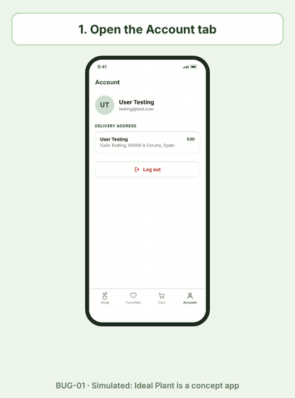
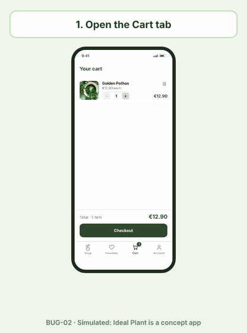
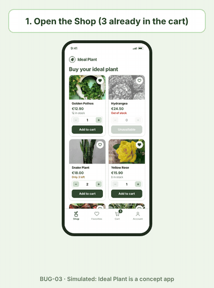

# Ideal Plant — Bug Report Examples

These are examples of bugs that are common in mobile e-commerce apps like Ideal Plant. They were not found in this project, since the app is a concept: they show how I would report them and which test cases in this repository would catch them.

The causes of bugs like these can vary, so each one always needs to be analysed by the team to find its root cause and to prevent it from happening again. For that reason, the reports describe what happens, not why.

Each report names the test case that finds it (see [test-cases.md](test-cases.md)).

**Severity** is how much the bug affects the app and its users. **Priority** is how urgently it must be fixed, based on the business needs. They are not always the same.

---

## BUG-01 · The user is still logged in after logging out and reopening the app

- **Severity:** High
- **Priority:** High
- **Version:** v1.0
- **Environment:** iOS and Android · Test environment

**Description:**
After tapping "Log out", closing the app and opening it again, the user is still logged in. The session should end with "Log out".

**Preconditions**
- The test user (testing@test.com) is logged in.

**Steps to reproduce**
1. Open the Account tab.
2. Tap "Log out".
3. On the Login screen, close the app (remove it from the recent apps).
4. Open the app again and wait for the splash screen to finish.

**Expected result:**
The Login screen is shown. After "Log out", the session ends and the user must log in again.

**Actual result:**
The Shop screen is shown and the user is logged in as User Testing, with access to the cart, the delivery address and the Account screen.

**Evidence:**

**Impact:**
On a shared or borrowed phone, another person can use the account, see the address and place orders.

**How it is caught:**
TC-SPL-02, row 3 ("logged in, tapped Log out and closed the app → Login").

---

## BUG-02 · "Pay" stays disabled after selecting Bizum

- **Severity:** High
- **Priority:** Critical
- **Version:** v1.0
- **Environment:** iOS and Android · Test environment

**Description:**
On the Checkout screen, selecting Bizum does not enable the "Pay" button, so the user cannot pay with Bizum. The other payment methods work.

**Preconditions**
- The test user is logged in.
- The cart contains 1 of plant1.

**Steps to reproduce**
1. Open the Cart tab.
2. Tap "Checkout".
3. Select Bizum as the payment method.
4. Look at the "Pay" button.

**Expected result:**
"Pay" is enabled and shows the order total, as it does for the other payment methods.

**Actual result:**
Bizum is shown as selected, but "Pay" stays disabled. With Card, PayPal or Cash on delivery, "Pay" is enabled.

**Evidence:**

**Impact:**
Users who want to pay with Bizum cannot buy. Severity is High rather than Critical because other payment methods still work, but priority is Critical: Bizum is widely used in Spain and every blocked user is a lost sale.

**How it is caught:**
TC-CHK-06, Bizum row ("Paying with each method opens the Confirmation").

---

## BUG-03 · The Shop lets the user add more units than the stock when the cart already has some

- **Severity:** High
- **Priority:** High
- **Version:** v1.0
- **Environment:** iOS and Android · Test environment

**Description:**
When the cart already contains units of a plant, the selector in the Shop still allows the full stock to be added again, so the cart ends up with more units than the stock.

**Preconditions**
- The test user is logged in.
- plant1 has a stock of 8 in the back office.
- The cart already contains 3 of plant1.

**Steps to reproduce**
1. Open the Shop.
2. On the card of plant1, tap "+" until it is disabled.
3. Tap "Add to cart".
4. Open the Cart tab.

**Expected result:**
The selector goes up to 5 (8 in stock minus 3 in the cart) and "+" is disabled at 5. The cart can never hold more than 8 of plant1.

**Actual result:**
The selector goes up to 8. After tapping "Add to cart", the cart contains 11 of plant1, more than the 8 in stock.

**Evidence:**

**Impact:**
Users can order plants that do not exist (overselling). The order has to be cancelled or partly refunded, which costs money and the user's trust.

**How it is caught:**
TC-SHOP-03, rows 4 and 5 (3 and 7 already in the cart). The test case was designed with boundary values for this rule.
