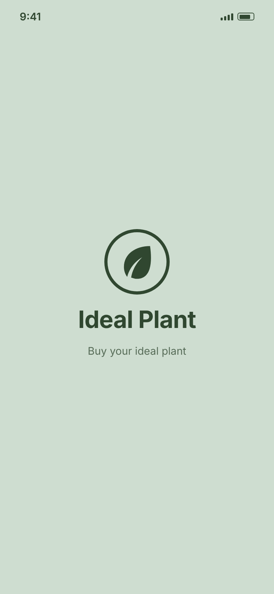
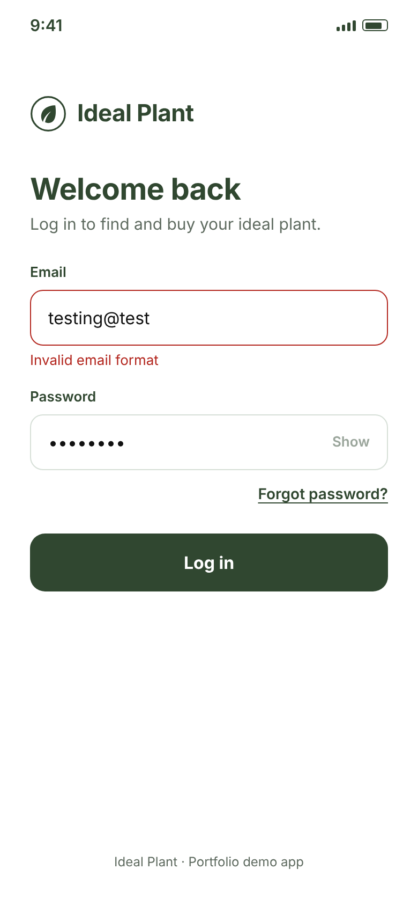
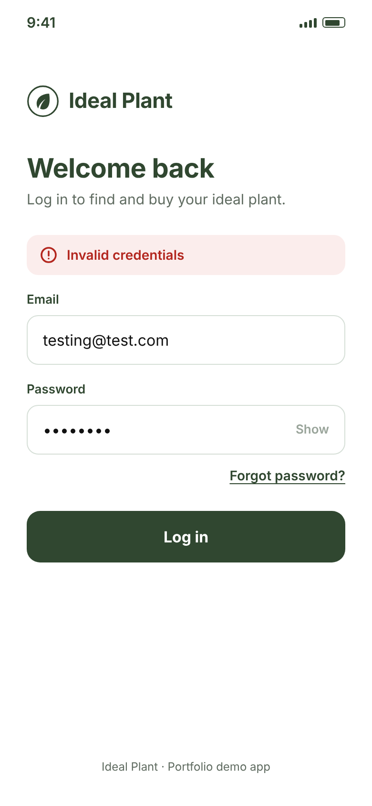
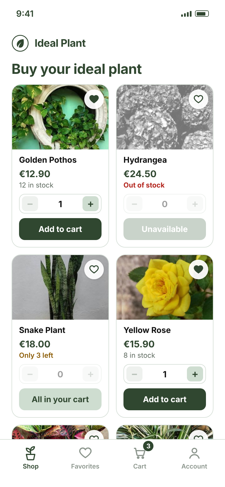
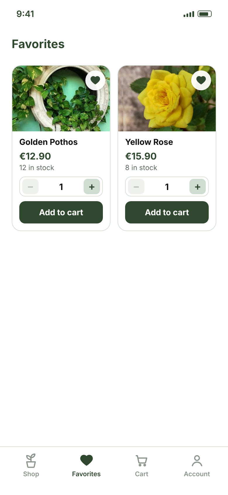
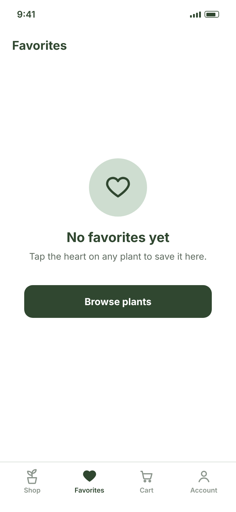
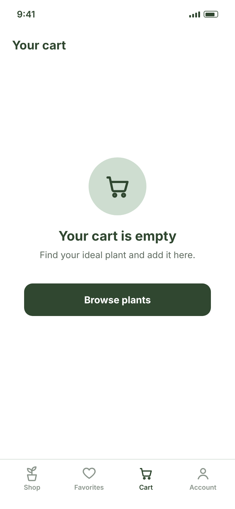
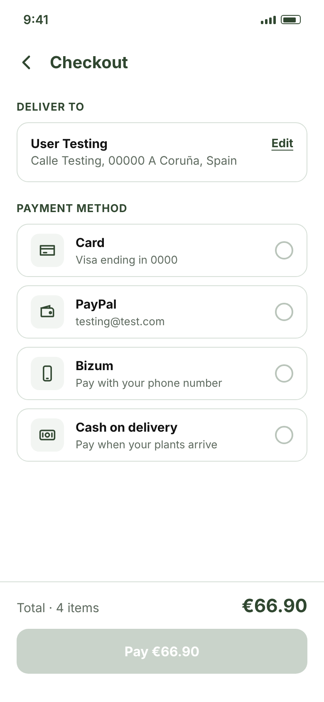
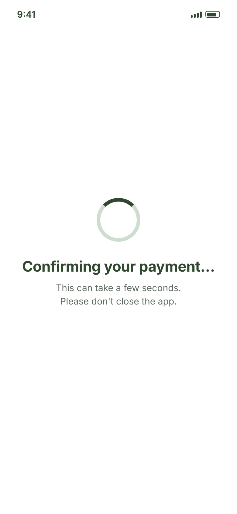
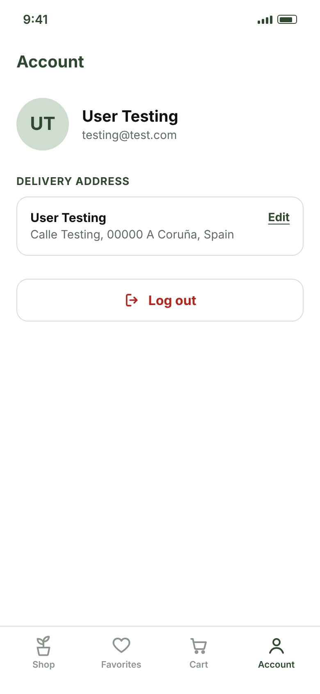

# Ideal Plant — Screens & Requirements

**Ideal Plant** is a concept mobile app (iOS and Android) for buying plants. The plant photos are my own, taken from my first web project, *The Ideal Plant*.

This document defines what the app must do, screen by screen. Every manual test case (see [test-cases.md](test-cases.md)) and every automated test in this repository traces back to a requirement ID below.

**How to read it**

- Each requirement has an ID made of the screen prefix and a number, e.g. `LOG-03`.
- *Out of scope* items are visible in the UI but are intentionally not specified or tested.
- The accessibility IDs the app must provide for the automated tests are listed in [accessibility-ids.md](accessibility-ids.md).

**App flow**

`Splash → Login → Shop → Cart → Checkout → Confirmation → Shop`

Favorites and Account can be opened at any time from the bottom tab bar.

**How product data works**

`Back office → Product & Stock API → Ideal Plant app`

Products are managed in a back office, where the team adds each plant with its name, price, photo and stock. The app gets this data from the Product & Stock API and shows what the API returns.

The plants shown in the screens are fake test data created by the development team in the test environment. They are examples, not real products. The requirements describe how the app behaves for the data it receives.

---

## Navigation (applies to several screens)

| ID | Requirement |
|---|---|
| `NAV‑01` | Shop, Favorites, Cart and Account show a bottom tab bar with four tabs: Shop, Favorites, Cart and Account. Splash, Login, Checkout and Confirmation do not show it. |
| `NAV‑02` | Tapping a tab opens its screen. The tab of the current screen is highlighted. |
| `NAV‑03` | The Cart tab shows the number of **units** in the cart (3 units of the same plant = 3). With an empty cart, no number is shown. |

---

## 1. Splash

| ID | Requirement |
|---|---|
| `SPL‑01` | When the app opens, the splash screen shows the Ideal Plant logo, the name "Ideal Plant" and the tagline "Buy your ideal plant" on a light green background. |
| `SPL‑02` | After about 2 seconds, the app moves on its own to the Login screen. If the user is already logged in, it moves to the Shop screen instead. Slower devices may take longer; this must not be treated as a failure. |

  

---

## 2. Login

| ID | Requirement |
|---|---|
| `LOG‑01` | The Login screen shows the Email and Password fields, a "Forgot password?" link and a "Log in" button. |
| `LOG‑02` | "Log in" is disabled until both fields contain text. |
| `LOG‑03` | When "Log in" is tapped and the email format is invalid, the "Invalid email format" message is shown under the Email field and the user is not logged in. |
| `LOG‑04` | When the email format is valid but the email or the password is wrong, the "Invalid credentials" message is shown above the Email field. The message must not reveal which of the two is wrong. |
| `LOG‑05` | With valid credentials, tapping "Log in" takes the user to the Shop screen. |
| `LOG‑06` | The password is hidden by default. Tapping "Show" reveals it and the button changes to "Hide"; tapping "Hide" hides it again. |
| `LOG‑07` | After a successful login, the user stays logged in when the app is closed and reopened, until the user taps "Log out". |

  
  
  

---

## 3. Shop

| ID | Requirement |
|---|---|
| `SHOP‑01` | The screen title is "Buy your ideal plant". |
| `SHOP‑02` | Four products are visible per view. |
| `SHOP‑03` | Each product card shows the photo, name, price, available stock, a heart (favorite) icon, a quantity selector (− / +) and an "Add to cart" button. |
| `SHOP‑04` | The quantity goes from 1 to the available stock. "−" is disabled at 1 and "+" is disabled at the maximum. |
| `SHOP‑05` | When the stock is 3 or less, the card shows "Only X left". |
| `SHOP‑06` | When the stock is 0, the card shows "Out of stock", the selector shows 0 and the button reads "Unavailable" and is disabled. |
| `SHOP‑07` | Tapping "Add to cart" adds the selected quantity to the cart, updates the Cart tab number and resets the selector to 1. If no more stock is available for the user, the selector shows 0 instead (see SHOP-09). Adding to the cart does not change the stock shown on the card; the stock only changes after a confirmed payment (see CONF-06). |
| `SHOP‑08` | The quantity the user can add is limited to the available stock minus what is already in the cart. Example: with a stock of 8 and 3 already in the cart, the selector goes from 1 to 5 and "+" is disabled at 5. |
| `SHOP‑09` | When the cart already holds all the available stock of a plant, its card shows 0 in the selector and a disabled "All in your cart" button. This is still true after leaving the Shop and coming back. |
| `SHOP‑10` | Tapping the heart adds the plant to Favorites (filled heart) or removes it (empty heart). |

  
  

---

## 4. Favorites

| ID | Requirement |
|---|---|
| `FAV‑01` | Favorites lists the favorite plants using the same card and the same rules as the Shop. |
| `FAV‑02` | Tapping the filled heart removes the plant from the Favorites screen. |
| `FAV‑03` | An out-of-stock plant can be added to Favorites. |
| `FAV‑04` | Favorites are kept after closing and reopening the app. |
| `FAV‑05` | With no favorites, the screen shows "No favorites yet" and a "Browse plants" button that opens the Shop. |

  
  

---

## 5. Cart

| ID | Requirement |
|---|---|
| `CART‑01` | Each product in the cart shows the photo, name, unit price, quantity selector, line total and a trash icon. |
| `CART‑02` | The quantity goes from 1 to the available stock. "−" is disabled at 1 and "+" is disabled at the maximum. A product is removed only with the trash icon, without a confirmation step. |
| `CART‑03` | The line total is the unit price times the quantity. The total (amount and number of units) updates immediately when a quantity changes or a product is removed. |
| `CART‑04` | With an empty cart, the screen shows "Your cart is empty" and a "Browse plants" button that opens the Shop. |
| `CART‑05` | "Checkout" opens the Checkout screen. |
| `CART‑06` | The cart is kept after closing and reopening the app. |

  
  

---

## 6. Checkout

| ID | Requirement |
|---|---|
| `CHK‑01` | Checkout shows the delivery address saved in the Account (with an "Edit" link), four payment methods (Card, PayPal, Bizum, Cash on delivery) and the order total. |
| `CHK‑02` | Only one payment method can be selected at a time. |
| `CHK‑03` | The "Pay" button is disabled until a payment method is selected. |
| `CHK‑04` | The "Pay" button shows the order total, which matches the cart total. |
| `CHK‑05` | Tapping "Pay" places the order and opens the Confirmation screen. |
| `CHK‑06` | Going back from Checkout returns to the Cart, which keeps its content. This applies to the back arrow, the Android system back (button or swipe) and the iOS swipe back gesture. |

  
  

---

## 7. Confirmation

| ID | Requirement |
|---|---|
| `CONF‑01` | While the payment is being confirmed, the screen shows "Confirming your payment…". |
| `CONF‑02` | Once confirmed, the screen shows "Order placed successfully!", says the details were sent by email and shows the order number. |
| `CONF‑03` | From either state, the user cannot go back to Checkout, neither with the Android system back (button or swipe) nor with the iOS swipe back gesture (prevents paying twice). |
| `CONF‑04` | After a successful order, the cart is empty. |
| `CONF‑05` | "Continue shopping" opens the Shop. |
| `CONF‑06` | After the payment is confirmed, the stock shown in the Shop is reduced by the quantities bought. |

  
  

---

## 8. Account

| ID | Requirement |
|---|---|
| `ACC‑01` | Account shows the user's initials, name, email, delivery address (with an "Edit" link) and a "Log out" button. |
| `ACC‑02` | "Log out" ends the session and opens the Login screen. Going back with the Android system back (button or swipe) or the iOS swipe back gesture must not return to the app as a logged-in user. |

  

---

## Out of scope

These are deliberate decisions to keep the project small and explainable:

- Creating an account and the "Forgot password?" flow
- Whether error messages disappear while the user is correcting the fields
- Session expiry (how long the user stays logged in without using the app)
- The address edit form (the "Edit" link exists, the form does not)
- Adding or editing payment cards
- Errors during payment (declined, failed or interrupted payments). In this phase, only successful payments are considered.
- External confirmation steps of the payment providers (PayPal login, Bizum approval in the bank app, card 3-D Secure)
- Filters and search in the Shop, and a product detail page
- How long the stock takes to update in the Shop after a purchase. This depends on the Product & Stock API.
- The back office and the Product & Stock API (their responses, errors and performance). The app is tested assuming the API returns correct data.
- What the cart and favorites contain after logging out and back in
- Loading more products when scrolling the Shop, and reaching the end of the product list

## Test data

All data is fictional, so that no real person's details are ever used.

| Field | Value |
|---|---|
| Name | User Testing |
| Email | testing@test.com |
| Delivery address | Calle Testing, 00000 A Coruña, Spain |
| Card | Visa ending in 0000 |
| PayPal | testing@test.com |
